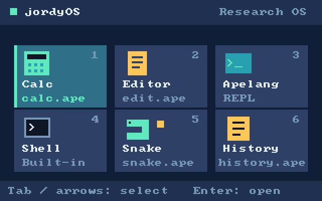
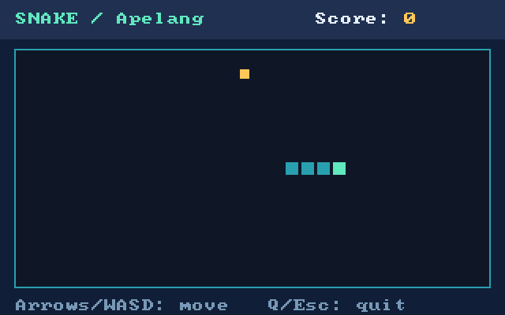
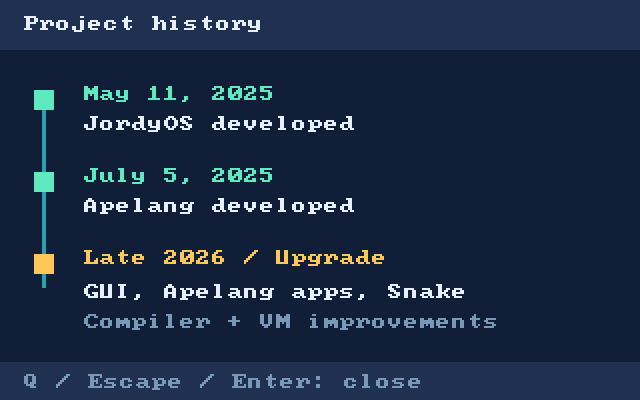

# JordyOS desktop and Apelang

JordyOS is a BIOS-booted 64-bit x86 research OS. Its native 320x200 VGA desktop
launches Calculator, Editor, the Apelang REPL, Snake, and a shell. Calculator,
Editor, and Snake are written in Apelang, in `programs/calc.ape`,
`programs/edit.ape`, and `programs/snake.ape`. A fourth Apelang application,
`programs/history.ape`, shows the project timeline.
The original C app sources are kept as historical examples and are not linked.
The Apelang compiler/runtime and these applications execute in ring 3 with
private page tables. Kernel, peer-memory and device access are blocked by the
CPU; input, graphics and RAM files use checked system calls. See
[ISOLATION.md](ISOLATION.md) for the boundary and its current limits.

## Build and run

Install Nix with flakes enabled. From a fresh checkout:

```sh
git clone --recurse-submodules https://github.com/duongddinh/OS-research-lab.git
cd OS-research-lab
# For an existing checkout:
git submodule update --init --recursive
nix develop
make -C jordyOS
make -C jordyOS run
```

For a bootable CD/DVD image, use `make -C jordyOS iso`. This creates
`jordyos.iso`; `make -C jordyOS run-iso` boots it in QEMU and `make -C jordyOS
test-iso` checks the CD layout and runs the application smoke suite from CD.
See [VIRTUAL_MACHINES.md](VIRTUAL_MACHINES.md) for legacy BIOS settings,
VirtualBox/VMware limitations, and the x86-versus-Arm host requirement.

The branch containing this integration must be checked out until it is merged.
`flake.lock` pins NASM, LLVM/Clang, LLD, QEMU, Python, and Make. `JORDY_CC`
selects the unwrapped compiler for the freestanding x86_64 target. QEMU uses
`qemu-system-x86_64 -cpu qemu64`. No Homebrew
cross-compiler or machine-wide installation is required.

## Desktop

Use Tab or the arrow keys to select a tile, Enter to open it, or keys 1–6 to
launch directly. Escape selects the shell. Closing a desktop-launched app
returns to the desktop. The initial GUI uses the keyboard; mouse navigation
and overlapping application windows are not implemented.

Apps open in a graphical terminal. Type `desktop` in the shell to reopen the
launcher. QEMU's serial port can also be used for commands and automation.

## Shell and applications

| Command | Behavior |
| --- | --- |
| `history` | Show the project timeline from `history.ape` |
| `snake` | Play the graphical Snake game written in `snake.ape` |
| `calc` | Run `calc.ape`: `add 5 2`, `sub`, `mul`, `div`; `exit` closes |
| `edit` | Run `edit.ape`, the line-oriented RAM-file editor |
| `ape` | Start the persistent Apelang REPL; `exit` returns |
| `ape demo.ape` | Compile and execute the bundled integration demo |
| `ape name.ape` | Compile and execute a source file in RAM |
| `compile helper.ape` | Compile a RAM source file to `helper.apb` |
| `apb name.apb` | Execute RAM bytecode |
| `ls` | List RAM files |
| `desktop` | Open the desktop |
| `clear` / `help` | Clear the terminal / show commands |
| `ebpfw help` | Native stateless IPv4 firewall commands |
| `net` | Network status; `net up` starts an attached RTL8139 |
| `larp` / `larp test` | Default TCP controller / synthetic LARP self-test |
| `tcp` / `tcp demo IP PORT` | TCP status / 16 KiB binary echo check using LARP |
| `tcp send IP PORT FILE` | Upload a RAM file, then wait for peer EOF |
| `tcp recv IP PORT FILE` | Download a RAM file (up to 16 KiB) |
| `tcp exchange IP PORT SOURCE DESTINATION` | Upload a RAM file and save the response |
| `arch` | Live long-mode/paging status, pointer width, and ABI self-test |
| `isolation` / `isolation test` | Isolation status / hardware fault and recovery checks |

The editor supports `new <fn>`, `open <fn>`, `show`, `edit`, `save [fn]`,
`list`, `delete <fn>`, and `quit`. In `edit` mode, enter text line by line;
a line containing only `.` finishes, and `.clear` empties the buffer.

To create and run a program:

```text
sh> edit
edit# new hello.ape
edit# edit
tree "Hello from my OS"
.
edit# save
edit# quit
sh> ape hello.ape
Hello from my OS
```

New portable language built-ins are `asktext()` (always a string),
`number(text)` (checked conversion), `files()` (newline-separated file names),
and `erase(path)` (boolean result). `ask()` keeps its original numeric-input
behavior. In JordyOS, file operations use the kernel RAM filesystem.

For modules, compile each dependency first. The bundled example is:

```text
sh> compile helper.ape
sh> ape module.ape
42
MODULE PASS
```

## Native firewall lab

The [native firewall guide](net/README.md) describes the first JordyOS firewall
milestone: ordered rules, incoming/outgoing policy hooks, counters, and an
isolated QEMU RTL8139 network path. The shell command is `ebpfw`; its backend
executes actual eBPF instructions in a checked interpreter, including upstream
ebpfw's XDP source-block function and shared rule matcher. `ebpfw bpf` reports
program validation, instruction counts, and the compiled object's SHA-256.
`ebpfw block from 192.0.2.1` installs an absolute source block enforced by the
XDP receive hook. The Linux Go binary, Netfilter hooks, and connection tracking
have not been ported. [Upstream attribution](net/bpf/UPSTREAM.md) identifies the
exact code and revision.

`make run` still starts without a network adapter. Use `make run-net` to attach
an RTL8139 on a QEMU user network with a loopback-only UDP forwarding
port. The guest interface starts down, the UDP listener starts off, and the
firewall starts disabled. Configure rules and enable filtering before `net up`.
Rules and counters are lost on reboot. IPv6, IP options, fragmentation,
connection tracking, routing and NAT are not implemented. The TCP client uses
LARP by default and resolves an on-link peer using ARP. See [net/LARP.md](net/LARP.md)
for the binary transfer demo, limits, and Linux interoperability tests.

## Project history

Press 6 on the desktop or type `history` in the shell. The history app displays
the author's development dates: JordyOS on May 11, 2025, Apelang on July 5,
2025, and the graphical desktop, applications, game, and runtime upgrade in
late 2026. Q, Escape, or Enter closes it. These dates are recorded in the
editable `programs/history.ape` source.

## Snake and game APIs

Press 5 on the desktop, or type `snake` in the shell. Enter starts or restarts,
arrows or WASD turn, and Q or Escape quits. Snake uses a 30x15 board, tracks
score, grows after food, rejects reverse turns, and ends on wall/body collision.
The rules and drawing calls are in `programs/snake.ape`, including `turn()`,
`step()`, `place_food()`, and `draw()`. The kernel contains no Snake rules.
The maximum length is 128; reaching it wins.

| Apelang built-in | Behavior |
| --- | --- |
| `paint(x, y, width, height, color)` | Draw a clipped filled rectangle |
| `drawtext(x, y, text_or_number, color)` | Draw text over the current image |
| `key()` | Nonblocking key name or `""`; arrows, enter, escape, and typed characters |
| `wait(milliseconds)` | Wait 1–1000 ms using the guest PIT timer |
| `random(limit)` | Deterministic pseudorandom integer in `[0, limit)` |

Colors are 0 navy, 1 panel, 2 card, 3 muted, 4 teal, 5 mint, 6 gold,
7 white, 8 ink, and 9 selection. The graphics canvas is 320x200 pixels.
Drawing, nonblocking input, and frame timing currently require JordyOS; on
a hosted VM they raise a catchable error. `random()` also works on the host.
Its fixed initial seed makes game tests reproducible; it is not cryptographic.

Snake has a fifty-million-instruction session budget. Other guest programs
retain the five-million-instruction budget. Frames are spaced by 120 ms.
The C platform layer supplies only drawing, input, and timing services.





## Architecture and changes

The BIOS loader keeps its remaining-sector counter separate from CHS disk
registers, retries failed reads, and advances ES for every sector. It loads
the kernel at physical `0x10000`, away from the bootloader at `0x7c00`.
The build rejects an image exceeding the reserved 448 KiB load area.

The bootloader selects VGA mode 13h and obtains the BIOS 8x8 ROM font before
entering protected mode. The kernel sets a small color palette and draws the
desktop and terminal into the framebuffer at `0xa0000`. The font API is
specified in the [IBM BIOS technical reference](https://www.ardent-tool.com/docs/pdf/PS2_and_PC_BIOS_Interface_Technical_Reference_Apr87.pdf).

The entry code enables A20, checks CPU capabilities, enters 32-bit protected
mode, builds a four-level page-table hierarchy using 2 MiB leaf pages, enables
long mode, and transfers to 64-bit code. It initializes x87/SSE2, clears BSS
above 1 MiB, and calls the x86-64 C kernel with a correctly aligned stack.
Each user runtime has a reusable private 4 MiB heap with 16-byte-aligned
allocations and a guarded 256 KiB user stack. The trusted kernel launcher
retains a 64 KiB stack and the shell has 16 KiB. The actual Apelang
compiler/lexer/VM compiled from the pinned submodule. Apelang bytecode runs
inside the 64-bit guest's ring-3 process. [ARCHITECTURE.md](ARCHITECTURE.md)
explains the boot stages, ELF64 builds, calling convention, and paging layout.

The serial console enables repeatable integration tests. The foreground app
owns console input until it exits; the shell cannot steal its keystrokes.
Task startup uses a trampoline so returning from an app exits it safely.
The context switch preserves the six SysV AMD64 callee-saved integer
registers and 64-bit stack pointers. User entry/exit uses a separate interrupt
gate, TSS kernel stack, and saved floating-point state. Only one foreground
user application runs at a time; there is no timer-driven preemption.

## Validation

```sh
nix develop --command make -C jordyOS test
```

The test boots `os.img` in headless QEMU and exercises source and bytecode
execution, modules, recursive functions, arrays/maps, file I/O, caught and
uncaught errors, REPL recovery, map growth, a 100,000-iteration allocation
loop, instruction-budget recovery, repeated application launches, and the
complete editor save/reopen/run/delete flow. Seven additional tests execute the actual Snake rules to verify eating,
growth, wall/self collision, turning, vacated-tail handling, food placement,
and winning at the array bound. The emulator test starts/exits Snake and
checks the game launcher. It also launches each Apelang
app from the desktop and verifies return to the launcher.

`test-boot` inspects the live CPU's CS/CR0/CR3/CR4/EFER registers and physical
page-table entries, checks the shell's mixed integer/floating-point ABI probe,
and verifies clean rejection of Pentium III, long-mode-disabled, and
SSE2-disabled and NX-disabled CPU models. The image builder rejects kernels that are not
ELF64 x86-64 executables. `make -C jordyOS test-boot` runs these checks alone.

`test-isolation` runs native ring-3 code that attempts forbidden kernel/peer
reads and writes, HLT, port I/O, CR3 access, code writes, data execution,
null/stack-guard accesses, and invalid system-call pointers. It checks actual
CPU exceptions and private page tables, then runs healthy applications after
the faults. `make -C jordyOS test-isolation` runs this group alone. Its serial
transcript defaults to `/tmp/jordyos-isolation.log` (`ISOLATION_LOG` override).

The same target runs native packet-decoder/policy tests and an isolated QEMU
network test. The network test injects real Ethernet frames into the emulated
RTL8139, checks ARP and ICMP/UDP responses, verifies drops in both directions,
and exercises malformed input, rule bounds, and receive-ring wrapping. See the
firewall guide for the individual test targets.

The serial transcript is written to `/tmp/jordyos-smoke.log` by default.
Set `QEMU` to choose another emulator binary and `SMOKE_LOG` for another log.

## Current limits

TCP LARP's portable core is pinned under `vendor/tcplarp` and is the native
TCP sender's default controller. `larp test` uses synthetic feedback;
`tcp demo` transfers real binary data. The first TCP implementation supports
one foreground, active-open stream, with files up to 16 KiB on the local /24;
there is no server/listen or user-process socket API. See [net/LARP.md](net/LARP.md).

This is an educational OS with CPU-enforced memory and privilege isolation for
Apelang application processes. Each launch gets private code, data, heap,
stack and page tables; memory faults terminate that process and return to the
kernel. The kernel shell, drivers and services remain privileged. Kernel
identity-mapped pages are still writable/executable; kernel faults halt the
guest. There is no per-user file access control, preemptive scheduling,
general-purpose network stack, persistent storage or dynamic native loader.
The shared RAM filesystem and display remain intentional services. The
optional network lab is limited to local
IPv4 on one QEMU RTL8139, ARP, ICMP echo, and an opt-in UDP echo listener.
Network polling depends on console/input loops, yields, and guest waits; a
CPU-bound application can delay reception. All RAM files are lost when QEMU restarts. There are
16 files, each limited to 16 KiB, with names up to 31 bytes. The built-in
application scripts can be edited in RAM; rebuilding restores their source.

A guest language execution has a five-million-instruction budget so an accidental
Apelang loop returns to the launcher or REPL. Memory isolation does not add
native CPU time limits or protect against bugs in privileged kernel services.
Font/input handling is ASCII
with a US keyboard layout. Numbers print with six significant digits; Unicode and terminal escape sequences are not implemented.

A browser demo on cytizennetworks.com is a separate follow-up: it needs an
isolated browser emulator and a reviewed deployment. This change does not
publish a website or alter Cytizen production infrastructure.
