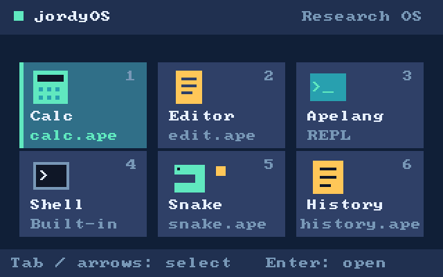
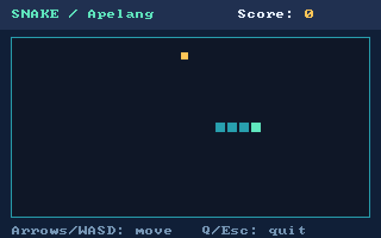
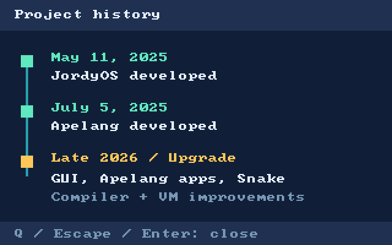

# JordyOS desktop and Apelang

JordyOS is a BIOS-booted 32-bit x86 research OS. Its native 320x200 VGA desktop
launches Calculator, Editor, the Apelang REPL, Snake, and a shell. Calculator,
Editor, and Snake are written in Apelang, in `programs/calc.ape`,
`programs/edit.ape`, and `programs/snake.ape`. A fourth Apelang application,
`programs/history.ape`, shows the project timeline.
The original C app sources are kept as historical examples and are not linked.

## Build and run

Install Nix with flakes enabled. From a fresh checkout:

```sh
git clone --recurse-submodules https://github.com/duongddinh/OS-research-lab.git
cd OS-research-lab
# For an existing checkout:
git submodule update --init --recursive
nix develop
make -C jordyOS
make -C jordyOS run
```

The branch containing this integration must be checked out until it is merged.
`flake.lock` pins NASM, LLVM/Clang, LLD, QEMU, Python, and Make. `JORDY_CC`
selects the unwrapped compiler for the freestanding i686 target. No Homebrew
cross-compiler or machine-wide installation is required.

## Desktop

Use Tab or the arrow keys to select a tile, Enter to open it, or keys 1–6 to
launch directly. Escape selects the shell. Closing a desktop-launched app
returns to the desktop. The initial GUI uses the keyboard; mouse navigation
and overlapping application windows are not implemented.

Apps open in a graphical terminal. Type `desktop` in the shell to reopen the
launcher. QEMU's serial port can also be used for commands and automation.

## Shell and applications

| Command | Behavior |
| --- | --- |
| `history` | Show the project timeline from `history.ape` |
| `snake` | Play the graphical Snake game written in `snake.ape` |
| `calc` | Run `calc.ape`: `add 5 2`, `sub`, `mul`, `div`; `exit` closes |
| `edit` | Run `edit.ape`, the line-oriented RAM-file editor |
| `ape` | Start the persistent Apelang REPL; `exit` returns |
| `ape demo.ape` | Compile and execute the bundled integration demo |
| `ape name.ape` | Compile and execute a source file in RAM |
| `compile helper.ape` | Compile a RAM source file to `helper.apb` |
| `apb name.apb` | Execute RAM bytecode |
| `ls` | List RAM files |
| `desktop` | Open the desktop |
| `clear` / `help` | Clear the terminal / show commands |

The editor supports `new <fn>`, `open <fn>`, `show`, `edit`, `save [fn]`,
`list`, `delete <fn>`, and `quit`. In `edit` mode, enter text line by line;
a line containing only `.` finishes, and `.clear` empties the buffer.

To create and run a program:

```text
sh> edit
edit# new hello.ape
edit# edit
tree "Hello from my OS"
.
edit# save
edit# quit
sh> ape hello.ape
Hello from my OS
```

New portable language built-ins are `asktext()` (always a string),
`number(text)` (checked conversion), `files()` (newline-separated file names),
and `erase(path)` (boolean result). `ask()` keeps its original numeric-input
behavior. In JordyOS, file operations use the kernel RAM filesystem.

For modules, compile each dependency first. The bundled example is:

```text
sh> compile helper.ape
sh> ape module.ape
42
MODULE PASS
```

## Project history

Press 6 on the desktop or type `history` in the shell. The history app displays
the author's development dates: JordyOS on May 11, 2025, Apelang on July 5,
2025, and the graphical desktop, applications, game, and runtime upgrade in
late 2026. Q, Escape, or Enter closes it. These dates are recorded in the
editable `programs/history.ape` source.

## Snake and game APIs

Press 5 on the desktop, or type `snake` in the shell. Enter starts or restarts,
arrows or WASD turn, and Q or Escape quits. Snake uses a 30x15 board, tracks
score, grows after food, rejects reverse turns, and ends on wall/body collision.
The rules and drawing calls are in `programs/snake.ape`, including `turn()`,
`step()`, `place_food()`, and `draw()`. The kernel contains no Snake rules.
The maximum length is 128; reaching it wins.

| Apelang built-in | Behavior |
| --- | --- |
| `paint(x, y, width, height, color)` | Draw a clipped filled rectangle |
| `drawtext(x, y, text_or_number, color)` | Draw text over the current image |
| `key()` | Nonblocking key name or `""`; arrows, enter, escape, and typed characters |
| `wait(milliseconds)` | Wait 1–1000 ms using the guest PIT timer |
| `random(limit)` | Deterministic pseudorandom integer in `[0, limit)` |

Colors are 0 navy, 1 panel, 2 card, 3 muted, 4 teal, 5 mint, 6 gold,
7 white, 8 ink, and 9 selection. The graphics canvas is 320x200 pixels.
Drawing, nonblocking input, and frame timing currently require JordyOS; on
a hosted VM they raise a catchable error. `random()` also works on the host.
Its fixed initial seed makes game tests reproducible; it is not cryptographic.

Snake has a fifty-million-instruction session budget. Other guest programs
retain the five-million-instruction budget. Frames are spaced by 120 ms.
The C platform layer supplies only drawing, input, and timing services.





## Architecture and changes

The BIOS loader keeps its remaining-sector counter separate from CHS disk
registers, retries failed reads, and advances ES for every sector. It loads
the kernel at physical `0x10000`, away from the bootloader at `0x7c00`.
The build rejects an image exceeding the reserved 448 KiB load area.

The bootloader selects VGA mode 13h and obtains the BIOS 8x8 ROM font before
entering protected mode. The kernel sets a small color palette and draws the
desktop and terminal into the framebuffer at `0xa0000`. The font API is
specified in the [IBM BIOS technical reference](https://www.ardent-tool.com/docs/pdf/PS2_and_PC_BIOS_Interface_Technical_Reference_Apr87.pdf).

The entry code enables A20, initializes x87 floating point, clears BSS above
1 MiB, and enters C. The runtime has a reusable 4 MiB heap with split/coalesce
allocation, a 64 KiB task stack, and the actual Apelang compiler/lexer/VM
compiled from the pinned submodule. Apelang bytecode runs on the guest CPU.

The serial console enables repeatable integration tests. The foreground app
owns console input until it exits; the shell cannot steal its keystrokes.
Task startup uses a trampoline so returning from an app exits it safely.

## Validation

```sh
nix develop --command make -C jordyOS test
```

The test boots `os.img` in headless QEMU and exercises source and bytecode
execution, modules, recursive functions, arrays/maps, file I/O, caught and
uncaught errors, REPL recovery, map growth, a 100,000-iteration allocation
loop, instruction-budget recovery, repeated application launches, and the
complete editor save/reopen/run/delete flow. Seven additional tests execute the actual Snake rules to verify eating,
growth, wall/self collision, turning, vacated-tail handling, food placement,
and winning at the array bound. The emulator test starts/exits Snake and
checks the game launcher. It also launches each Apelang
app from the desktop and verifies return to the launcher.

The serial transcript is written to `/tmp/jordyos-smoke.log` by default.
Set `QEMU` to choose another emulator binary and `SMOKE_LOG` for another log.

## Current limits

This is an educational OS running trusted programs in kernel address space.
There is no process isolation, paging, networking, persistent storage, or
preemptive scheduling. All RAM files are lost when QEMU restarts. There are
16 files, each limited to 16 KiB, with names up to 31 bytes. The built-in
application scripts can be edited in RAM; rebuilding restores their source.

A guest execution has a five-million-instruction budget so an accidental
infinite loop returns to the launcher or REPL. The heap and filesystem are
bounded, but the VM is not a security sandbox. Font/input handling is ASCII
with a US keyboard layout. Numbers print with six significant digits; Unicode and terminal escape sequences are not implemented.

A browser demo on cytizennetworks.com is a separate follow-up: it needs an
isolated browser emulator and a reviewed deployment. This change does not
publish a website or alter Cytizen production infrastructure.
